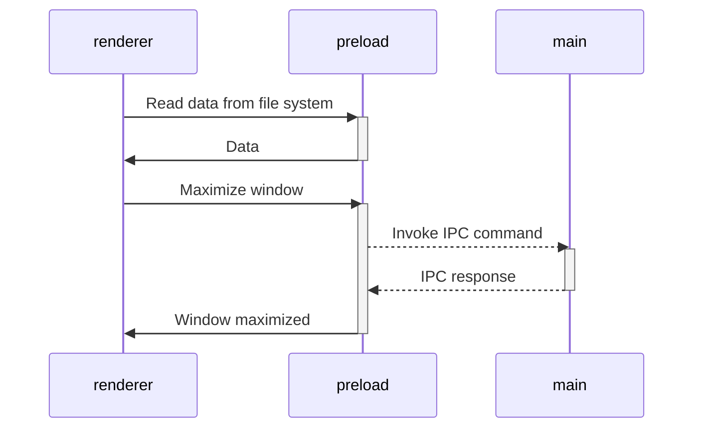

## Getting Started

This project uses **Yarn Berry (v4+)** as its package manager. The initial setup requires a few manual steps to correctly generate and configure the renderer (the UI of your app).

1.  **Clone the repository**
    Click the **[Use this template](https://github.com/cawa-93/vite-electron-builder/generate)** button (you must be logged in) or clone this repo.

2.  **Set Up Yarn**
    Navigate into the project folder and set the Yarn version. This ensures you are using the modern, required version.

    ```sh
    yarn set version stable
    ```

3.  **Create the Renderer**
    Run the renderer creation script using Node. This will launch an interactive process to scaffold your UI package (e.g., with React, Vue, etc.).

    ```sh
    node packages/integrate-renderer/create-renderer.js
    ```

    The script will create a new folder named `renderer` in the project root.

4.  **Configure the Renderer Workspace**
    For the project to recognize the new UI package, you must move it and edit its `package.json`:
    - **Move** the newly created `renderer` folder into the `packages` directory.
    - **Open** `packages/renderer/package.json` and change the `name` field to `@app/renderer`.
      ```json
      // packages/renderer/package.json
      {
        "name": "@app/renderer",
        "private": true
        // ...
      }
      ```

5.  **Install Dependencies**
    Now that all workspaces are in place, install all project dependencies from the **root directory**.

    ```sh
    yarn install
    ```

6.  **Integrate the Renderer**
    Run the final integration script. This will automatically modify the renderer's configuration to make it compatible with Electron.

    ```sh
    yarn run integrate-renderer
    ```

7.  **Start Developing\!**
    That's all you need. Start the application in development mode:

    ```sh
    yarn start
    ```

---

## Features

### Lightweight

This template is minimal, using the platform's native features to the maximum and minimizing third-party dependencies.

### Electron

- Uses the latest Electron version with all the latest security patches.
- The application architecture is built according to security [guides](https://www.electronjs.org/docs/tutorial/security) and best practices.
- The latest version of [electron-builder][electron-builder] is used to package the application.

### Automatic Tests

- End-to-end https://www.google.com/search?q=tests are placed in the root [`tests`](https://www.google.com/search?q=tests) directory and use [playwright][playwright].
- You may write unit https://www.google.com/search?q=tests inside each package.

### Continuous Integration & Auto-Update

- A configured GitHub Actions workflow checks types on each push.
- Code signing is supported.
- Pushing to the `main` branch creates and deploys a new application version, which will be automatically downloaded by existing installations.

---

## Project Structure

The project is a monorepo where each part of the application is an independent package. All internal package names are prefixed with `@app/*`.

### Build Tool Packages:

- [`packages/integrate-renderer`](https://www.google.com/search?q=packages/integrate-renderer): A helper package used during setup to configure the new interface package.
- [`packages/electron-versions`](https://www.google.com/search?q=packages/electron-versions): A set of helper functions to get the versions of internal components bundled with Electron.

### App Logic Packages:

- [`packages/main`](https://www.google.com/search?q=packages/main): Implementation of Electron's [**main script**](https://www.electronjs.org/docs/tutorial/quick-start#create-the-main-script-file).
- [`packages/preload`](https://www.google.com/search?q=packages/preload): Implementation of Electron's [**preload scripts**](https://www.electronjs.org/docs/latest/tutorial/tutorial-preload).

### Renderer Is Not Included

The repository does not contain a pre-built interface package. This allows you to use any web application (React, Vue, Svelte, etc.) as the renderer. The only requirement is that the template expects to import the renderer package by the name `@app/renderer`, which is handled during the "Getting Started" steps.

---

## How It Works

### Compilation

When an application is ready to distribute, you compile it into an executable using [electron-builder][electron-builder].

- **Local Compilation**: `yarn run compile`. This creates an executable for sharing but without auto-update support.
- **Release & Auto-Update**: Pushing to `main` triggers a GitHub Action that builds, signs, and publishes a new release to GitHub Releases, enabling auto-updates for all users.

### Working with Dependencies

The `renderer` is a standard web application, so you can use any browser-compatible dependencies (React, Vue, axios, etc.).

Dependencies that require Node.js APIs (like accessing the filesystem) **cannot** be used directly in the renderer. Instead, they must be used in the [`preload` script](<https://www.google.com/search?q=%5Bhttps://www.electronjs.org/docs/latest/tutorial/process-model%23preload-scripts%5D(https://www.electronjs.org/docs/latest/tutorial/process-model%23preload-scripts)>), and their functionality can be securely exposed to the renderer.

#### Exposing Node APIs to the Renderer

This template uses ES Modules to simplify communication. You can export a function from the `preload` package, and it will be automatically and securely exposed to the renderer using `electron.contextBridge`.

**Example:** Reading a file in `preload` and using it in `renderer`.

```ts
// packages/preload/src/index.ts
import { readFile } from "node:fs/promises";

// This function will be securely exposed to the renderer.
export function getUserData(): Promise<{ prop: string }> {
  return readFile("/path/to/user/file.json", { encoding: "utf8" }).then(JSON.parse);
}
```

Now you can import and call the method directly in your renderer code.

```ts
// packages/renderer/src/any-component.ts
import { getUserData } from "@app/preload";

const userData = await getUserData();
```

The architecture of interaction between all modules is as follows:



---

## Available Scripts

`yarn start`
Starts the application in development mode with hot-reload.

`yarn run build`
Runs the `build` command in all workspaces.

`yarn run compile`
Builds all packages and then compiles the project into an executable using `electron-builder`.

`yarn run compile -- --dir -c.asar=false`
Compiles without creating an installer and with the app content unpacked (not in an `.asar` archive). Useful for debugging the final packaged app.

`yarn test`
Executes end-to-end https://www.google.com/search?q=tests on the compiled app using Playwright.

`yarn run typecheck`
Runs the `typecheck` command in all workspaces.

`yarn run create-renderer`
A script that scaffolds a new Vite project. This is the first step of the initial setup.

`yarn run integrate-renderer`
A script that configures the newly created renderer to work with the Electron template. This is the final step of the initial setup.
